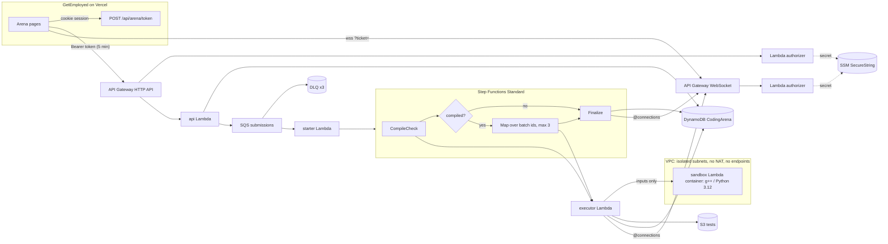

# Coding Arena backend (AWS, CDK)

The judge behind GetEmployed's **Coding Arena**: users submit C++ or Python, the code is compiled and run against hidden tests in a sandbox with no network, and verdicts stream back live. The GetEmployed app and its auth stay where they are (Vercel). Only code execution runs on AWS, in **ap-south-1 (Mumbai)**, sized to stay within the free tier.

## Architecture



1. `POST /submissions`: the API validates the request, applies the rate limit (one submission per user per 10 s, as a conditional DynamoDB write), stores the submission as `QUEUED`, and sends `{submissionId}` to SQS.
2. The **starter** Lambda (ESM `maxConcurrency` 2) starts an execution named after the submission. Because the name is fixed, a redelivered message can't start a second run.
3. **CompileCheck** compiles once (`compileOnly`) and fails fast with Compile Error. **Map** runs batches of up to 5 tests, 3 at a time. Items carry only `{submissionId, batchId}`; test data never enters the state (256 KB limit).
4. The **executor** reads a batch from S3 and invokes the sandbox synchronously with the inputs only. It compares the outputs itself (token-wise; optional 1e-6 float checker), so user code never sees an expected output. Once a batch fails, later batches are skipped.
5. **Finalize** (Aggregate and Finalize in one state, to save transitions) writes the verdict and the per-test pass/fail, time and memory, with no test data. It records the solve and pushes the result over the WebSocket. `GET /submissions/{id}` is the polling fallback.

## The sandbox

| Layer                                                                                                                               | What it stops                                                                               |
| ----------------------------------------------------------------------------------------------------------------------------------- | ------------------------------------------------------------------------------------------- |
| VPC with isolated subnets, a security group with no egress, no NAT and no endpoints                                                 | Any network, including AWS APIs                                                             |
| IAM role with only `AWSLambdaVPCAccessExecutionRole` (logs + ENI)                                                                   | AWS access, even with credentials                                                           |
| `runbox` seccomp filter: `socket`, `connect`, `ptrace`, `process_vm_*`, `bpf`, `io_uring`, `mount`, `unshare`… return EPERM         | The Lambda Runtime API on 127.0.0.1:9001 (forging a response), reading the handler's memory |
| Empty child environment, handler marked non-dumpable                                                                                | Reading `AWS_*` credentials from the environment or `/proc/<pid>/environ`                   |
| `setrlimit` CPU, AS, STACK, FSIZE (16 MB), NPROC 32, NOFILE 64, CORE 0; own session; wall clock 3×TL + 1 s; kill of the whole group | Infinite loops, memory hogs, fork bombs, huge output, fd exhaustion                         |
| Kill every process of the sandbox user and wipe `/tmp` and `/dev/shm` **at the start and end** of every invocation                  | Leftovers in a reused warm environment, reading an earlier submission's files               |
| Reserved concurrency 5 (context `sandboxReservedConcurrency`)                                                                       | One user exhausting the account                                                             |

- Verdicts: TLE = CPU time over the limit or the wall clock hit. MLE = peak RSS over the limit, or an allocation failure under RLIMIT_AS. RE = a signal or a non-zero exit. Output hitting the 16 MB file cap is Wrong Answer.
- Limits: C++17 `-O2` with `<bits/stdc++.h>` precompiled, 2 s and 256 MB by default; Python 3.12 gets 2.5× the time (5 s).
- Known limitation: a program can kill its own runner, since it runs as the same uid. The executor then records a Runtime Error, which only affects that submission.

## Why each service

| Service                                        | Why                                                                                                               |
| ---------------------------------------------- | ----------------------------------------------------------------------------------------------------------------- |
| API Gateway HTTP API                           | Cheapest REST front door, built-in CORS, Lambda authorizer with a 60 s cache, stage throttling (20 rps, burst 40) |
| API Gateway WebSocket                          | Live progress and verdicts without polling; connections stored in DynamoDB with a TTL                             |
| Lambda (Node 22 arm64, plus one x86 container) | Pay per use, always free (1M requests and 400k GB-s a month)                                                      |
| SQS + DLQ                                      | Buffers contest-style bursts so the judge runs at a steady rate; a DLQ after 3 receives                           |
| Step Functions Standard                        | Fan-out over test batches with retries and catches; 4,000 free transitions a month                                |
| DynamoDB (provisioned 5/5 ×3)                  | Always free up to 25 RCU/WCU; a single table with TTL                                                             |
| S3                                             | Test files, private, SSE-S3, SSL only; setters upload with presigned PUT URLs                                     |
| ECR (CDK assets repo)                          | The sandbox image                                                                                                 |
| SSM Parameter Store Standard SecureString      | The token secret, at no cost (Secrets Manager isn't free)                                                         |
| CloudWatch + SNS + Budgets                     | 5 alarms (free tier is 10), email alerts, a $1 budget                                                             |

## DynamoDB: table `CodingArena` (PK, SK; GSI1, GSI2; TTL `ttl`)

| Access pattern                               | Key condition                                                                                                                                                                                     |
| -------------------------------------------- | ------------------------------------------------------------------------------------------------------------------------------------------------------------------------------------------------- |
| Get problem / editorial / test manifest      | `PK=PROBLEM#<slug>`, `SK=META` / `EDITORIAL` / `TESTS`                                                                                                                                            |
| List an arena's problems                     | GSI1 `GSI1PK=ARENA#<arena>`, `begins_with(GSI1SK, "P#")` (sorted `P#<difficulty>#<order>#<slug>`). Topic, difficulty, company, role and search filters run in the Lambda over a 60 s cached list. |
| List an arena's MCQ sets                     | GSI1 `GSI1PK=ARENA#<arena>`, `begins_with(GSI1SK, "M#")`                                                                                                                                          |
| Submission by id                             | `PK=SUB#<id>`, `SK=META` (TTL 1 year)                                                                                                                                                             |
| A user's submissions for a problem (history) | GSI1 `GSI1PK=USER#<u>#P#<slug>`, newest first by `GSI1SK=createdAt`                                                                                                                               |
| A user's solved set                          | `PK=USER#<u>`, `begins_with(SK, "SOLVED#")`                                                                                                                                                       |
| A user's MCQ attempts                        | `PK=USER#<u>`, `begins_with(SK, "MCQ#")`                                                                                                                                                          |
| Rate limit                                   | `PK=USER#<u>`, `SK=RATE`: conditional update `lastAt <= now − 10 s`                                                                                                                               |
| WebSocket connection                         | `PK=CONN#<id>`, `SK=META` (TTL 2 h); a user's connections via GSI2 `GSI2PK=USER#<u>`                                                                                                              |

## HTTP API

All routes need `Authorization: Bearer <arena token>`; `/admin/*` also needs `adm: true`.

`GET /problems?arena=&topic=&difficulty=&company=&role=&q=` · `GET /problems/{slug}` · `GET /problems/{slug}/editorial` · `GET /problems/{slug}/submissions` · `POST /submissions {slug, language, code}` → 202 or 429 · `GET /submissions/{id}` · `GET /me/progress` · `GET /mcq?arena=` · `GET /mcq/{setId}` (no answers) · `POST /mcq/{setId}/attempts {answers[]}` · `GET|PUT /admin/problems/{slug}` · `POST /admin/problems/{slug}/tests/upload-urls {count}` · `POST /admin/problems/{slug}/tests/commit {count}` · `POST /admin/problems/{slug}/validate` · `PUT /admin/mcq/{setId}`

WebSocket messages: `{type: "progress", submissionId, done, total, label}` and `{type: "verdict", submissionId, submission}`.

## Cost and the free tier

Nothing in the stack bills by the hour: **no NAT gateway, no interface endpoints, no Elastic IPs, no EC2/ECS/RDS, no Secrets Manager.**

| Item                       | Usage per submission (4 batches)                                | Free allowance                                             | Free submissions a month                                                                                  |
| -------------------------- | --------------------------------------------------------------- | ---------------------------------------------------------- | --------------------------------------------------------------------------------------------------------- |
| Step Functions transitions | about 8 (Compile, Choice, Map, 4 iterations, Finalize)          | 4,000 (always free)                                        | **about 500**, the binding limit. After that, $0.025 per 1,000 transitions (about $0.0002 per submission) |
| Lambda GB-seconds          | sandbox ≈ 1 GB × 5 × ~3 s ≈ 15                                  | 400,000 (always free)                                      | ~25,000                                                                                                   |
| Lambda requests            | ~10                                                             | 1M                                                         | 100,000                                                                                                   |
| DynamoDB                   | ~10 writes, a few reads                                         | 25 RCU/WCU provisioned (we use 15/15)                      | burst-limited, not billed                                                                                 |
| SQS                        | 3 requests, plus ESM long polling (~650k requests a month idle) | 1M (always free)                                           | fine                                                                                                      |
| API Gateway                | ~10 calls + a few WS messages                                   | 12-month free tier or credits (HTTP $1.20/M in ap-south-1) | cents at most                                                                                             |
| ECR storage                | 2 images × ~300 MB                                              | 500 MB a month (12-month free tier)                        | ≈ $0.01 a month over                                                                                      |
| CloudWatch Logs            | ~10 KB, kept 7 days                                             | 5 GB                                                       | fine                                                                                                      |
| KMS (aws/ssm decrypts)     | authorizer cold starts only                                     | 20,000 requests                                            | fine                                                                                                      |

A **$1 budget** emails at the first $0.01 actual, at $1 actual, and at $1 forecast. New AWS accounts (after July 2025) get Free Tier credits that cover any overage above.

## Prerequisites

- Docker Desktop (it builds the sandbox image), AWS CLI v2, Node 22, Python 3 (test generation)
- AWS credentials for the target account (`aws sts get-caller-identity`)

## Deploy

```sh
cd infra/coding-arena
# 1. Check the sandbox locally first (in a second terminal: pnpm sandbox:run)
pnpm sandbox:build && pnpm sandbox:run
SANDBOX_URL=http://localhost:9000 pnpm test:sandbox

# 2. The token secret (once). CloudFormation can't create SecureStrings, so this is outside CDK.
aws ssm put-parameter --region ap-south-1 --name /coding-arena/token-secret --type SecureString \
  --value "$(openssl rand -base64 48)"
#    Put the same value in GetEmployed's ARENA_TOKEN_SECRET.

# 3. Bootstrap once, then keep only the last 2 images in the CDK assets repository
npx cdk bootstrap aws://<account>/ap-south-1
aws ecr put-lifecycle-policy --region ap-south-1   --repository-name cdk-hnb659fds-container-assets-<account>-ap-south-1   --lifecycle-policy-text file://scripts/ecr-lifecycle.json

# 4. Review, then deploy
pnpm diff -c alertEmail=<you@example.com> -c allowedOrigins=http://localhost:4000,https://<prod-origin>
pnpm deploy -c alertEmail=<you@example.com> -c allowedOrigins=...      # writes outputs.json
#    Confirm the SNS subscription email.

# 5. Content and checks
pnpm content:build && pnpm seed
SANDBOX_FUNCTION=<SandboxFunction output> pnpm test:sandbox
SANDBOX_FUNCTION=<SandboxFunction output> pnpm content:verify
ARENA_TOKEN_SECRET=<secret> pnpm test:e2e
```

If `aws lambda get-account-settings` reports `ConcurrentExecutions: 10`, either request 1,000 in Service Quotas (free) or deploy with `-c sandboxReservedConcurrency=0`. SQS `maxConcurrency` 2 × Map 3 still caps the sandbox at 6 at once.

## Teardown

```sh
pnpm destroy
# The table and the bucket are retained on purpose; delete them by hand when you're sure:
aws dynamodb delete-table --table-name <TableName>
aws s3 rb s3://<TestsBucket> --force
aws ssm delete-parameter --name /coding-arena/token-secret
```

## GetEmployed env vars (`.env` / Vercel)

| Variable               | Value                                                        |
| ---------------------- | ------------------------------------------------------------ |
| `ARENA_API_URL`        | `HttpApiUrl` output                                          |
| `ARENA_WS_URL`         | `WebSocketUrl` output                                        |
| `ARENA_TOKEN_SECRET`   | the SSM parameter's value (≥ 32 characters)                  |
| `ARENA_ADMIN_USER_IDS` | comma-separated GetEmployed user ids allowed to set problems |

## Content

Judged problems live in `content/{dsa,logic}/<slug>/`: `meta.json` (tags, limits, examples, hints, complexity, resources), `statement.md`, `input.md`, `output.md`, `constraints.md`, `editorial.md`, `starter.{cpp,py}`, `solution.{cpp,py}`, `gen.py`, and an optional `brute.py`. `pnpm content:build` generates tests deterministically (not committed). Expected output comes from the Python reference and is cross-checked against `brute.py` on small tests; the build also checks that examples 1..k equal tests 1..k. `pnpm content:verify` runs **both** references through the real sandbox. MCQ sets are `content/{aptitude,cs}/<setId>.json`.

Content must be original. Company and role tags mean "relevant practice for this company or role", never "this company asked this question".
